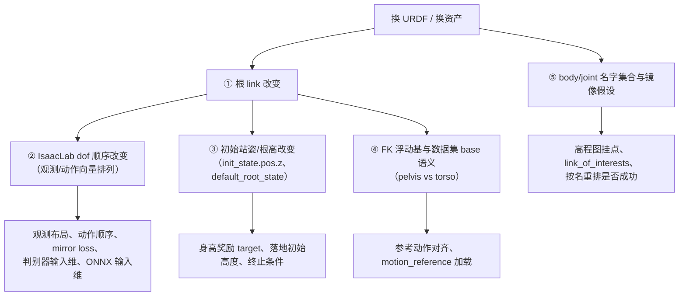

# URDF 替换修改指南（以 `instinct_xu` 为模板）

> **适用对象**：使用 `instinct_xu`（IsaacLab + 自研 `instinct_rl`）作项目源框架、需要把
> 机器人的 URDF/资产换成另一份（换版本、换厂商、换根 link）的同学。
> **模板来源**：G1 从"popsicle（torso 为根）"换成"官方 rev1.0（pelvis 为根）"的完整改造，
> 已通过 **locomotion（AMP 行走 P1）** 与 **越障（Perceptive Vault）** 两条技能的训练+回放验证。
>
> **一句话结论**：换 URDF 真正的难点**不是**模型能不能加载，而是**训练接口（关节顺序、
> 观测布局、基座语义）会不会静默错位**。本文给出 9 步操作 + 5 级验证 + 一份可直接跑的
> 验证脚本 `instinct/tools/verify_urdf_swap.py`。

---

## 0. 先记住三条铁律

| # | 铁律 | 违反后的现象 |
|---|---|---|
| 1 | **IsaacLab 的关节顺序无法从 URDF 推导**，只能运行时实测 | 训练能起、但策略学不动；回放抽搐、踝/髋乱动 |
| 2 | **"根 link 变了" ⇒ 关节遍历序必然变** ⇒ 所有按位置切片的观测/动作全部错位 | 换根后旧 ckpt 直接不可用（这是**预期行为**，不是 bug） |
| 3 | **参考动作数据集（retarget npz）的 `base_pos_w` 记的是 pelvis**，而 FK 用 URDF 的根 link | 参考整体偏一个 torso−pelvis 常量（G1 = **4.4 cm**），越障这类足部接触任务直接被带偏 |

---

## 1. 换 URDF 会同时改变 5 件事



**四套顺序**（这是最容易踩坑的地方，务必分清）：

| 名字 | 含义 | 本次 rev1.0 实测值 |
|---|---|---|
| `NPZ_ORDER` | **URDF `<joint>` 声明序**，也等于 AMP 参考动作 npz 的 `joint_names` 序 | 左腿6 → 右腿6 → 腰3 → 左臂7 → 右臂7 |
| `MUJOCO_ORDER` | **MJCF ctrl（执行器声明）序** | 腰3 → 左腿6 → 右腿6 → 左臂7 → 右臂7 |
| **MJCF 状态序** | `qpos[7:] / qvel[6:]`，按 `jnt_qposadr` 排 | **= `NPZ_ORDER`** |
| `PELVIS_ORDER` / `ISAACLAB_ORDER` | **IsaacLab 策略侧序**（换根后变了） | `pelvis` 根 ⇒ 髋优先（下文附录 A） |

> ⚠️ **MJCF 的 ctrl 序 ≠ 状态序**：写 `ctrl` 用 `MUJOCO_ORDER`，读 `qpos/qvel` 必须用
> **状态序**。旧 popsicle 资产两者恰好相同，所以历史上没人发现；换成官方 rev1.0 后
> **立刻暴露**。实现见 `instinct/tools/joint_order.py::mujoco_state_order_from_model`。

---

## 2. 交付清单：本次修改涉及的文件（模板）

> 下表中的"新增/修改"是相对 `instinct_xu.zip`（修改前基线）的差异。
> 路径前缀 `XU = instinct_xu/source/instinctlab/instinctlab`。

### 2.1 资产与训练侧配置（**必改**）

| 文件 | 变更 | 关键内容 |
|---|---|---|
| `XU/assets/resources/unitree_g1/official_rev10/g1_29dof_rev_1_0.urdf` ＋ `meshes/`（35 个 STL） | 新增 | 官方 rev1.0 URDF，`root = pelvis`，29 受驱动关节 / 9 fixed，总质量 **33.3411 kg** |
| `XU/assets/unitree_g1.py` | 修改 | 新增 `G1_29DOF_REV10_PELVIS_CFG`（≈ L576 起）：`UrdfFileCfg` 指向新 URDF、`init_state.pos.z = 0.7585`、默认站姿 `joint_pos`，执行器沿用 `beyondmimic_g1_29dof_actuators` |
| `XU/tasks/locomotion/config/g1/__init__.py` | 修改 | 注册 `Instinct-Amp-Walk-Pelvis-G1-v0` / `-Play-v0`（≈ L804–814），`entry_point=G1AmpWalkP1TeacherEnv`（带契约校验） |

### 2.2 关节序与契约（**必改，核心**）

| 文件 | 变更 | 关键内容 |
|---|---|---|
| `XU/tasks/locomotion/config/g1/amp_walk_p1_contract.py` | 新增 | ① `P1_JOINT_ORDER` = 换根后**实测**的 29 关节序（**唯一真相源**）② 观测契约 `P1_OBSERVATION_SIZE == 1500` ③ 运行时校验器（env 实例化时 fail-fast） |
| `XU/tasks/locomotion/config/g1/amp_walk_p1_env_cfg.py` | 新增 | 展平后的自包含 env cfg（由 `instinct/tools/flatten_cfg.py generate` 生成，**只加注释、别手改结构**） |
| `XU/tasks/locomotion/config/g1/agents/amp_walk_p1_ppo_cfg.py` | 新增 | `mirror_joint_names = P1_JOINT_ORDER`（镜像损失按新序） |
| `XU/utils/mirror.py` | 新增 | 矢状面镜像算子：`left_* ↔ right_*` 互换、**pitch 保号 / roll·yaw 反号**、腰部 yaw− roll− pitch+ |

### 2.3 越障/参考动作侧（**换根后必查**）

| 文件 | 变更 | 关键内容 |
|---|---|---|
| `XU/tasks/shadowing/beyondmimic/config/g1/beyondmimic_vault_cfg.py` | 修改 | 新增 `VAULT_FK_URDF`（≈ L28–45）：**FK 改用 pelvis 为根的官方 URDF**，因为数据集 `base_pos_w` 记的是 pelvis；用 torso 根会让参考**整体穿地 −2.7~−3.7 cm**（当 torso 用时），改用 pelvis 后最低点恰好 `+0.000 m` |

### 2.4 本地回放侧（`instinct/`，不在 `instinct_xu` 里）

| 文件 | 变更 | 关键内容 |
|---|---|---|
| `instinct/assets/official_rev10/g1_29dof_rev_1_0.xml` | 新增 | 官方 MJCF（同一机器人） |
| `instinct/assets/g1_29dof_rev10_play.xml` | 新增 | **可回放的 MJCF**：注入 29 个 `<position>` 执行器（kp/kv 由 `armature·(10Hz·2π)²` 推出）+ 默认站姿 `<keyframe>`（根高 **0.7585**）+ 地面 |
| `instinct/tools/build_g1_mjcf.py` | 修改 | 支持 pelvis 根：`--init-root-height 0.7585`、`--strip-actuator`、`--strip-scene`；生成后自动回读校验（`nu==29`、`nkey==1`、ctrl 序 == `MUJOCO_ORDER`） |
| `instinct/tools/joint_order.py` | 修改 | 新增 `PELVIS_ORDER`（换根实测序）与 `ORDER_CANDIDATES["p1"]`；新增 `mujoco_state_order_from_model()`（解决"状态序 ≠ ctrl 序"） |
| `instinct/tools/g1_mujoco_play.py` | 修改 | `--asset auto\|legacy\|rev10` 预设（auto 按路径线索推断）；`ASSET_FINGERPRINTS`（`root_body/nu/nq/init_root_z`）；`--verify-model` 与训练 URDF 逐 link 比对 |

### 2.5 支撑工具（照抄即可，与 URDF 无关但强烈建议一起移植）

| 文件 | 作用 |
|---|---|
| `instinct/tools/joint_order.py` | 四套顺序的唯一定义 + 重排索引 |
| `instinct/tools/verify_urdf_swap.py` | **本文交付的验证脚本**（见 §5 V1） |
| `instinct_xu/scripts/instinct_rl/dump_io.py` | 云端导出"策略观测/动作 + 原始 qpos/qvel"快照，用于交叉验证观测构造（见 §5 V4） |
| `instinct/tools/cloud_p1_smoke.py` | 云端冒烟：资产路径、`init_z`、高程图挂点、观测 1500、关节序 29（见 §5 V3） |
| `instinct/tools/flatten_cfg.py` | 配置展平 + 等价性机检（`generate` / `verify`） |

---

## 3. 分步操作

### Step 1 — 资产落地

```bash
# 训练侧（IsaacLab 直接读 URDF）
XU/assets/resources/<vendor>/<your_asset>/{
    robot.urdf          # 模型定义
    meshes/             # URDF 里 <mesh filename> 指向的目录（布局必须自洽，见下）
}
# 本地回放侧（官方 MJCF，同机器人）
instinct/assets/<your_asset>/robot.xml
```

- ⚠️ **目录布局必须与 URDF 里的引用写法一致**，两种常见写法不能混：
  | URDF 里写的 | 实际要求 | 本项目谁在用 |
  |---|---|---|
  | `meshes/x.STL` | `meshes/` 就在 URDF **同级** | 新资产 `official_rev10/`（自包含） |
  | `../meshes/x.STL` | `meshes/` 在 URDF 的**上级** | 旧资产 `urdf/` + 共享 `meshes/` |
  ⇒ 只换 URDF 文件、不调目录 ⇒ **加载直接失败**（`verify_urdf_swap.py` 会提前抓到）。
- **meshes 内容怎么办**：详见 §7.1 —— 本项目的实测结论是"**大多不用换，但必须放对位置**"。
- MJCF 侧：`build_g1_mjcf.py` 会把 `meshdir` 写成**绝对路径**（与仓库位置绑定，克隆到别处要重生成）。
- 记录指纹，后面每一步都要用它自证"跑的就是这个模型"：

```bash
sha256sum <your>.urdf
python - <<'PY'
import xml.etree.ElementTree as ET
r = ET.parse('<your>.urdf').getroot()
m = sum(float(l.find('inertial/mass').get('value')) for l in r.findall('link') if l.find('inertial') is not None)
print(f'links={len(r.findall("link"))} joints={len(r.findall("joint"))} mass={m:.4f} kg')
PY
```

### Step 2 — 训练侧资产 cfg（IsaacLab）

在 `XU/assets/<robot>.py` 里**新增一份 cfg**（不要改旧的！旧 cfg 是别的任务的基线）：

```python
<YOUR>_CFG = ArticulationCfg(
    spawn=sim_utils.UrdfFileCfg(
        fix_base=False,
        replace_cylinders_with_capsules=True,
        asset_path=f"{__file_dir__}/resources/<vendor>/<your>/robot.urdf",
        activate_contact_sensors=True,
        rigid_props=..., articulation_props=...,
        joint_drive=sim_utils.UrdfConverterCfg.JointDriveCfg(   # ⚠️ PD 增益交给 actuator 配置
            gains=sim_utils.UrdfConverterCfg.JointDriveCfg.PDGainsCfg(stiffness=0, damping=0)
        ),
    ),
    init_state=ArticulationCfg.InitialStateCfg(
        pos=(0.0, 0.0, <根 link 离地高度>),      # ⭐ 必须实测，不是猜
        joint_pos={...默认站姿...},
        joint_vel={".*": 0.0},
    ),
    soft_joint_pos_limit_factor=0.9,
    actuators=<沿用原执行器配置>,
)
```

- **`init_state.pos.z` 怎么定**：让机器人处于默认站姿、脚掌刚好着地时，**根 link 的离地高度**。
  换根后它**一定变**（G1：torso `0.82` → pelvis `0.7585`，差值 0.0440 与模型一致）。
  它同时是身高奖励的目标（`default_root_state[:, 2]`）⇒ 用它当 target 才不需要改奖励函数。
- 执行器 `effort_limit_sim / armature / stiffness / damping` 若沿用旧的，**务必**保证
  关节名正则（`".*_hip_pitch_joint"` 等）能覆盖新模型的所有关节名 —— 这是最隐蔽的失效点。

### Step 3 — 注册训练任务

在 `XU/tasks/<skill>/config/<robot>/__init__.py` 里注册（**新 id，别覆盖旧的**）：

```python
gym.register(
    id="Instinct-<Your>-v0",
    entry_point=<YourContractValidator>,     # 见 Step 9
    disable_env_checker=True,
    kwargs={"env_cfg_entry_point": f"{__name__}.<your>_env_cfg:<Your>EnvCfg",
            "instinct_rl_cfg_entry_point": f"{agents.__name__}.<your>_ppo_cfg:<Your>PPORunnerCfg"},
)
```

### Step 4 — 关节序对齐（**核心步骤**）

四套顺序各司其职，**不要互相替代**：

| 用途 | 用哪套顺序 | 代码位置 |
|---|---|---|
| 策略观测/动作向量 | **IsaacLab 实测序** | 契约常量（本模板 `P1_JOINT_ORDER`） |
| 写 MuJoCo `ctrl` | `MUJOCO_ORDER` | `joint_order.py` |
| 读 MuJoCo `qpos/qvel` | **MJCF 状态序** | `mujoco_state_order_from_model()` |
| 参考动作 npz 列 | `NPZ_ORDER`（但**优先按名字重排**） | `joint_order.py` |

> ⭐ **能按名字就别按位置**：加载器（`motion_reference`）本来就是按 `joint_names` 重排的，
> 只要**名字**对得上，列序无关。位置切片只应出现在"策略接口"这一层。

### Step 5 — 云端实测 articulation 序（**无法跳过**）

IsaacLab 把 URDF 转 USD 后的 dof 顺序，**既不等于** `<joint>` 声明序、**也不等于** link/DFS 序。
规律是"按树的深度分层、同层 L/R 成对、父刚体先被访问者在前" —— 所以**换根必然改序**。
只能实测，两种办法：

```bash
# 办法 A（推荐，最直接）：dump_io.py 会打印 articulation 序
python scripts/instinct_rl/dump_io.py --task <Your-Play-v0> \
    --load_run <run> --load_checkpoint model_0.pt \
    --steps 1 --out /root/io0.npz --headless
#   → 日志里的 [joint_names(articulation order)] 就是权威顺序

# 办法 B：冒烟脚本自检（本模板 cloud_p1_smoke.py）
OMNI_KIT_ACCEPT_EULA=YES python /root/cloud_p1_smoke.py
```

把实测值回填到**契约常量（唯一真相源）**，并同步到 `instinct/tools/joint_order.py`
的 `ORDER_CANDIDATES`（供本地回放用）。

### Step 6 — 生成可回放的本地 MJCF

```bash
python instinct/tools/build_g1_mjcf.py \
    --base   instinct/assets/<your_asset>/robot.xml \
    --out    instinct/assets/<your>_play.xml \
    --init-root-height <根 link 离地高度> \
    --strip-actuator --strip-scene
```

- 为什么必须补执行器：InstinctMJ/InstinctLab 的 G1 MJCF **本身 `nu=0`**，直接加载无法闭环。
- 为什么 `--strip-actuator/--strip-scene`：官方 MJCF 自带 `<motor>` 和天空盒/棋盘地面，
  不剥会与自建执行器、注入地面冲突。
- 生成脚本会**自动回读校验**：`nu==29`、`nkey==1`、ctrl 序 == `MUJOCO_ORDER`。
- ⚠️ 关节阻尼/摩擦要**逐关节覆盖**（per-joint 优先于 `<default>`）：训练侧没有额外关节阻尼，
  而基础 MJCF 常带全局 `damping=0.5 / frictionloss=0.1` ⇒ 不覆盖会让回放"更粘、步幅偏小"。

### Step 7 — FK / 参考动作 base 对齐（**越障类任务的隐藏杀手**）

`MotionReferenceManager._initialize_robot_kinematics` 用 **URDF 的根 link** 建 FK 链，
而 retarget 数据集的 `base_pos_w` 记的是 **pelvis**：

| 用哪个基座做 FK | 实测结果（`g1_speed_vault_retargeted.npz`） |
|---|---|
| 把 base 当 **torso** 用 | 全模型最低点 **−0.027 ~ −0.037 m（穿地）** |
| 把 base 当 **pelvis** 用 | **+0.000 m（恰好着地）** ✅ |

⇒ 换资产时**必须**确认"FK 用的根"与"数据集 base 的语义"一致，否则参考整体平移
`torso_z − pelvis_z`（G1 = 4.4 cm）。修正方式就是在 FK 侧显式指向以 pelvis 为根的 URDF：

```python
_G1_RESOURCES_DIR = os.path.dirname(os.path.dirname(G1_CFG.spawn.asset_path))
VAULT_FK_URDF = os.path.join(_G1_RESOURCES_DIR, "<your_asset>", "robot.urdf")
```

#### ⚠️ 7.1 越障类必须把"机器人资产"和"FK URDF"**成对切换**

这是本项目最容易漏的一条（原实现里就存在这处不一致）：

| 位置 | 本项目当时的值 |
|---|---|
| 机器人本体 `G1_CFG`（`perceptive_vault_cfg.py:33` / `beyondmimic_vault_cfg.py:27`） | **`G1_29DOF_TORSOBASE_POPSICLE_CFG`（torso 根）** |
| FK / 参考动作 `VAULT_FK_URDF` | **official_rev10（pelvis 根）** |

两者根不同，而**三个腰关节的符号恰好相反**（实测：设 `waist_* = +0.3 rad` 时，
torso 相对 pelvis 的旋转向量 popsicle 得 `−0.3`、rev10 得 `+0.3`）。加载器只按名重排、
**没有符号翻转逻辑** ⇒ 观测里 `joint_pos_ref`（参考腰角）与 `joint_pos`（机器人腰角）**腰部分反号**。

**影响有多大（实测结论：别过度担心，也别无视）**：

- ✅ **可训练、可收敛**：越障奖励是 **link/body 级**模仿
  （`base_position_imitation_gauss`、`base_rot_imitation_gauss`、
  `link_pos/rot/lin_vel/ang_vel_imitation_gauss`）+ `joint_pos_limits` / `action_rate_l2`，
  **没有 joint 级跟踪项** ⇒ 策略只要把躯干朝向做对就拿得到奖励，网络只需多学一层 negate。
- ⚠️ **可移植性差**：这样训出的 ckpt 与**那个机器人资产绑定**。把同一 ckpt 拿到换过根的
  机器人上回放 ⇒ **腰会反相**、步态别扭（≠ ckpt 坏了，是符号约定不匹配）。

**所以做越障时必须二选一，不要混**：

1. **两者都用新资产**（推荐）：`G1_CFG = <新资产 CFG>` **且** `VAULT_FK_URDF = <新资产 URDF>`
2. **两者都用旧资产**：`G1_CFG = popsicle` **且** FK 也用 torso 根 URDF（但参考会偏 4.4 cm，见上）

**自查命令（腰关节设 +0.3，看躯干转哪边）**：

```bash
python - <<'PY'
import mujoco
for xml in ("instinct/assets/g1_29dof_popsicle_play.xml",
            "instinct/assets/g1_29dof_rev10_play.xml"):
    m = mujoco.MjModel.from_xml_path(xml); d = mujoco.MjData(m)
    t = mujoco.mj_name2id(m, mujoco.mjtObj.mjOBJ_BODY, "torso_link")
    p = mujoco.mj_name2id(m, mujoco.mjtObj.mjOBJ_BODY, "pelvis")
    d.qpos[:] = 0; d.qpos[3:7] = (1, 0, 0, 0)
    j = mujoco.mj_name2id(m, mujoco.mjtObj.mjOBJ_JOINT, "waist_pitch_joint")
    d.qpos[int(m.jnt_qposadr[j])] = 0.3
    mujoco.mj_forward(m, d)
    R = d.xmat[t].reshape(3, 3) @ d.xmat[p].reshape(3, 3).T
    print(f"{xml.split('/')[-1]:32s} waist_pitch=+0.3 -> {R[2, 1] - R[1, 2]:+.3f}")
PY
# 两个数字同号 = 符号一致；异号 = 符号相反（必须修正）
```

### Step 8 — 观测 / 动作 / 奖励里"跟根走"的东西

逐个检查（G1 换根的实际情况）：

| 项 | 旧（torso 根） | 新（pelvis 根） |
|---|---|---|
| 高程图挂点 `height_scanner.prim_path` | `.../Robot/torso_link` | `.../Robot/pelvis` |
| 运动参考 `motion_reference.prim_path` | `.../Robot/torso_link` | `.../Robot/pelvis` |
| `link_of_interests` | 不含 pelvis | **加入 `pelvis`**（+ torso_link 等共 14 个） |
| 身高奖励 | `track_base_height`（torso，靶 0.82） | `track_pelvis_height`（pelvis，靶 **0.7585**） |
| 动作尺度 | 逐关节 `0.25·effort/kp` | **不变**，但按新关节序排列 |

#### ⚠️ 8.1 `motion_reference.prim_path` 必须是**新的 articulation 根**（否则直接起不来）

换根后最容易漏的一条，实测报错原文：

```
RuntimeError: Failed to find a valid prim view class for the prim paths:
/World/envs/env_.*/Robot/torso_link, For robot motion reference,
only accept articulated prims for now.
```

原因：旧资产 root = `torso_link`，所以 `prim_path=".../Robot/torso_link"` **恰好**就是
articulation 根；换成 pelvis 根后它变成**子 link** ⇒ 不再是 articulated prim。

**必须同步改**（本项目实际改动）：

| 字段 | 旧值 | 新值 |
|---|---|---|
| `MotionReferenceManagerCfg.prim_path` | `{ENV_REGEX_NS}/Robot/torso_link` | `{ENV_REGEX_NS}/Robot/pelvis` |
| `MotionReferenceManagerCfg.reference_prim_path` | `/World/envs/env_.*/RobotReference/torso_link` | `/World/envs/env_.*/RobotReference/pelvis` |

⚠️ 注意区分：**高程图/相机的 `prim_path` 是 Sensor 类型，不必跟着换根**（本项目保留
`Robot/torso_link`，因为 rev10 也有该 link；挂在躯干上才看得见前方地形）。

### Step 9 — 契约校验器（fail-fast，最重要的工程习惯）

把"关节序 + 观测布局 + 关键常量"写成**运行时断言**，让配置错误**在训练第 0 秒就崩**，
而不是跑 3 天发现学不动。本模板：`amp_walk_p1_contract.py`（在 env 实例化时逐项核对
`P1_JOINT_ORDER`、`P1_OBSERVATION_SIZE == 1500`、`init_z == 0.7585`、资产路径、挂点…）。

---

## 4. 本次修改后的权威关节信息

见**附录 A**（29 关节四套顺序对照 + 重排索引）。这份数据由
`instinct/tools/verify_urdf_swap.py` 直接从 URDF/MJCF 读出，可直接贴给同学做对照。

---

## 5. 验证流程（5 级，从便宜到贵）

| 级 | 手段 | 命令 | 通过标准 |
|---|---|---|---|
| **V1** 静态 | 本文交付脚本 | `python instinct/tools/verify_urdf_swap.py --urdf <新>.urdf --xml <新的>_play.xml [--npz <motion>.npz]` | 退出码 0；关节名集合齐备；根 body 一致 |
| **V2** 本地回放 | MuJoCo + `.pt`/`.onnx` | `python instinct/tools/g1_mujoco_play.py --asset auto --policy <pt或onnx> --duration 0` | 能站住并跟随指令；**`.pt` 能跑通就说明顺序接对了** |
| **V3** 云端冒烟 | 配置层 | `OMNI_KIT_ACCEPT_EULA=YES python /root/cloud_p1_smoke.py` | 资产路径/init_z/挂点/观测维/关节数 全 ✅ |
| **V4** 云端 IO 交叉 | 观测构造 | `python scripts/instinct_rl/dump_io.py --task ... --out /root/io.npz --headless` | 本地按云端的 `qpos/qvel` 复现出的观测，与云端**逐段一致** |
| **V5** 兜底 | `.npz` 参考动作回放 | 见 §6 | 参考动作能渲染/对齐，机器人形态正确 |

> ⭐ **V2 是"最省事、最有说服力"的验收**：`.pt`（或导出的 `.onnx`）**能正常执行回放**，
> 基本就等价于"关节顺序、观测布局、动作尺度、资产几何都对上了"。
> ⚠️ 唯一例外：**越障类**任务本地 MuJoCo 没有障碍地形 ⇒ 行为要在云端 IsaacLab 回放里看。

---

## 6. 兜底：`.pt` 回放困难时，用 `.npz` 数据集回放

`.pt` 回放跑不通**不代表资产换错了**（可能是观测历史帧、teacher/student 结构、深度相机等
本地不具备的条件）。此时退一步，只用**参考动作数据集**验证"模型与接口是否自洽"：

```bash
# 1) 数据集 → 本地 MuJoCo 渲染（含障碍箱；不依赖任何策略/观测布局）
python instinct/tools/render_vault_motion.py \
    --npz <motion>.npz --base-body pelvis --stills 8 \
    --out instinct/eval/<your>_motion_replay.mp4

# 2) 只查接口一致性（不跑策略）
python instinct/tools/verify_urdf_swap.py --urdf <新>.urdf --xml <新的>_play.xml --npz <motion>.npz
```

判据：
- ✅ 渲染出的机器人在 `+0.000 m` 着地、关节动作符合参考（不穿地、不抽） ⇒ 资产几何 + 关节名对齐 OK
- ✅ 脚本报"可按**名字**对齐" ⇒ 数据管线不需要改
- ❌ 报出缺失关节 ⇒ 必须修资产或改管线（此时**不要**硬上策略回放）

---

## 7. 意外状况排查对照表

| 症状 | 最可能原因 | 处理 |
|---|---|---|
| `ValueError: Prim path '...' is not global` | 生成/展平的 cfg 里把 `{ENV_REGEX_NS}` 写成了字面量；`configclass.copy()` 重跑 `__post_init__` 把它"退回"占位符 | 改成绝对正则 `/World/envs/env_.*`（见 §8 坑 1） |
| 训练能起但学不动 / 奖励不涨 | **关节序对接错**（观测与动作用了不同顺序） | V1 + V4 |
| 回放抽搐、高频挣扎、摔倒 | `--asset` 选错（用旧资产的关节序跑新策略） | `--asset auto` 或显式 `rev10`；跑 `--verify-model` 自证 |
| 回放中踝/腰动作明显异常 | 把 **MJCF ctrl 序**当成**状态序**读了 `qpos/qvel` | 用 `mujoco_state_order_from_model()` |
| 参考动作整体穿地约 4 cm | FK 用 torso 根而数据集 base 是 pelvis | Step 7 |
| 身高奖励恒为负、高度总差一截 | 奖励靶值还是旧根的高度 | 改成新根的实测高度（Step 2 的 `init_state.pos.z`） |
| 观测维度 assert 失败（如期望 1500 收到 626） | 观测项集合/历史帧数跟根变了 | 用**按项名**推导布局（参考 `utils/mirror.py` 的 `from_obs_format` 写法），别写死常数 |
| 换根后旧 ckpt 加载报 `size mismatch` | **预期行为**：观测维/关节序变了 | 旧 ckpt 只能用于旧资产；新资产必须重新训练 |
| 训练与回放不能并存（OOM / PhysX 分配失败） | 大 env 数训练占满显存后，PhysX 还需一次性 2 GB | **回放前先停训**（回放完再续训） |
| 模型加载报"找不到 mesh / file not found" | URDF 的 `<mesh filename>` 与目录布局不匹配（见 §7.1） | 跑 `verify_urdf_swap.py`，它会逐条列出无法解析的引用 |

### 7.1 关于 meshes 的三个问题（组内高频提问）

> **Q1：框架里的 meshes 不用改吗？**

**A：内容大多不用改，但"放哪儿"必须改对。** 本项目实测（新旧两套资产对比）：

| 检查项 | 实测结果 |
|---|---|
| 新 URDF 引用 mesh 数 | 35（写法 `meshes/x.STL`） |
| 旧 URDF 引用 mesh 数 | 35（写法 `../meshes/x.STL`） |
| 两边**同名文件** | 35 个（名字完全一致） |
| 其中**内容完全相同** | **34 / 35** ✅ |
| 其中**内容不同** | **1 个**：`head_link.STL`（932 KB vs 337 KB，头部外观） |
| 旧目录缺文件 | 0 个 |

为何 34/35 完全相同：旧 popsicle 资产本来就是从官方 rev1.0 **派生**的（只改了"根选谁"与
腰关节父子方向，几何几乎同源），所以连 `torso_link_rev_1_0.STL` 这类带版本后缀的文件两边都有。

⇒ **真正必须做的是三件事**（只换 URDF 文件是不够的）：

1. **让引用能被解析**：新 URDF 写 `meshes/x.STL` ⇒ `meshes/` 必须与 URDF **同级**；
   若沿用旧的 `../meshes/` 写法 ⇒ `meshes/` 必须在**上级**。两者搞反 ⇒ 加载失败。
2. **视觉一致性**：只有 `head_link.STL` 有实质差异 ⇒ 在意外观就换成新的；
   它**不影响**碰撞/动力学（fixed link，且 IsaacLab `merge_fixed_joints=True` 会并入 torso）。
3. **本地回放 MJCF 要重新生成**：`meshdir` 是**绝对路径**，换人 clone 后必须重跑
   `build_g1_mjcf.py`。

> **Q2：不换 meshes，会影响质量/惯量/关节顺序吗？**

**A：都不会。**

- **质量/惯量**：来自 URDF 的 `<inertial>`（而不是 mesh）。本项目 IsaacLab 侧
  `link_density=0.0` ⇒ **不会从 mesh 体积反推质量**。所以"换 mesh 会不会让机器人变重"这个担心不存在。
- **关节顺序**：由**关节树（`<joint>` 的 parent/child）** 决定，与 mesh **完全无关**。
  换 mesh 不可能改变策略侧顺序——顺序变的唯一原因是**换根**。
- **碰撞/视觉**：这两项**确实**由 mesh 决定（`collider_type='convex_hull'` 由 mesh 生成碰撞体），
  所以踩了"mesh 缺文件"就会看到加载失败，而不是"静默跑偏"。

> **Q3：那怎么快速确认自己没搞错？**

```bash
python instinct/tools/verify_urdf_swap.py --urdf <你的>.urdf
# 看 "mesh 引用" 一节：
#   ✅ 可解析 n/n + 路径风格（自包含式 / 共享式）  ⇒ 布局正确
#   ❌ 逐条列出无法解析的引用 ⇒ 修目录布局（这是致命的，退出码 1）
```

脚本支持 3 种写法：`meshes/x.STL`、`../meshes/x.STL`、`package://pkg/...`（后者只能提示，
需 IsaacLab/ROS 侧能解析）。

### §8 三个高频"隐形"坑

1. **`{ENV_REGEX_NS}` 必须写成绝对正则 `/World/envs/env_.*`**
   IsaacLab `configclass.copy()` 会**重跑 `__post_init__`**（`sensors/sensor_base.py:59
   self.cfg = cfg.copy()`）。生成类若把 `prim_path` 字面量写进 `__post_init__`，运行期
   `InteractiveScene.format()` 替换好的路径会被**退回成占位符** ⇒ `SensorBase` 拿到
   `{ENV_REGEX_NS}/Robot` ⇒ 上面那条 `Prim path ... is not global`。
2. **别把配置展平后手改结构**：展平文件由 `flatten_cfg.py` 生成，改结构下次重生成就被覆盖。
   要长期维护的断言代码请放到**单独的** `*_contract.py`。
3. **MJCF 全局关节阻尼/摩擦要逐关节覆盖**：见 Step 6 最后一条。

---

## 9. 关键代码文件（对方改出问题时对照分析用）

按"症状 → 该看哪个文件"组织：

| 你遇到的问题 | 先看这个文件 | 看什么 |
|---|---|---|
| 关节序/观测维不对 | `XU/tasks/locomotion/config/g1/amp_walk_p1_contract.py` | `P1_JOINT_ORDER`、`P1_OBSERVATION_SIZE`、校验器断言 |
| 资产字段配错 | `XU/assets/unitree_g1.py::G1_29DOF_REV10_PELVIS_CFG` | `asset_path`、`init_state`、`actuators` |
| 注册/入口不对 | `XU/tasks/locomotion/config/g1/__init__.py`（≈L804–814） | 任务 id、`entry_point`、cfg 路径 |
| 参考动作错位/穿地 | `XU/tasks/shadowing/beyondmimic/config/g1/beyondmimic_vault_cfg.py` | `VAULT_FK_URDF`、数据集契约注释 |
| 本地回放顺序/资产 | `instinct/tools/joint_order.py` | 四套顺序、`ORDER_CANDIDATES`、状态序函数 |
| 本地回放选错资产 | `instinct/tools/g1_mujoco_play.py` | `ASSET_PROFILES`、`detect_asset_profile`、`ASSET_FINGERPRINTS`、`verify_model_vs_urdf` |
| 回放模型与训练不一致 | `instinct/tools/build_g1_mjcf.py` | 执行器注入、阻尼覆盖、keyframe 根高 |
| 观测构造与云端不一致 | `instinct_xu/scripts/instinct_rl/dump_io.py` | 打印的 obs layout / action joint order |
| 镜像损失报错 | `XU/utils/mirror.py` | 符号规则、扫描布局 `SCAN_LAYOUTS` |

---

## 附录 A — 本次修改后的关节信息（权威数据，可直接对照）

**资产**：`official_rev10/g1_29dof_rev_1_0.urdf`
**根 link**：`pelvis`　|　**受驱动关节**：29　|　**fixed**：9　|　**总质量**：33.3411 kg
**URDF `<joint>` 声明序 == `NPZ_ORDER`**（左腿 → 右腿 → 腰 → 左臂 → 右臂）

| # | 关节名 | parent → child | axis |
|---|---|---|---|
| 0 | `left_hip_pitch_joint` | pelvis → left_hip_pitch_link | (0,1,0) |
| 1 | `left_hip_roll_joint` | left_hip_pitch_link → left_hip_roll_link | (1,0,0) |
| 2 | `left_hip_yaw_joint` | left_hip_roll_link → left_hip_yaw_link | (0,0,1) |
| 3 | `left_knee_joint` | left_hip_yaw_link → left_knee_link | (0,1,0) |
| 4 | `left_ankle_pitch_joint` | left_knee_link → left_ankle_pitch_link | (0,1,0) |
| 5 | `left_ankle_roll_joint` | left_ankle_pitch_link → left_ankle_roll_link | (1,0,0) |
| 6–11 | `right_hip_pitch/roll/yaw`, `right_knee`, `right_ankle_pitch/roll` | 同上（右侧） | (0,1,0)/(1,0,0)/(0,0,1)/(0,1,0)/(0,1,0)/(1,0,0) |
| 12 | `waist_yaw_joint` | pelvis → waist_yaw_link | (0,0,1) |
| 13 | `waist_roll_joint` | waist_yaw_link → waist_roll_link | (1,0,0) |
| 14 | `waist_pitch_joint` | waist_roll_link → torso_link | (0,1,0) |
| 15–21 | `left_shoulder_pitch/roll/yaw`, `left_elbow`, `left_wrist_roll/pitch/yaw` | torso_link → … | (0,1,0)/(1,0,0)/(0,0,1)/(0,1,0)/(1,0,0)/(0,1,0)/(0,0,1) |
| 22–28 | `right_shoulder_pitch/roll/yaw`, `right_elbow`, `right_wrist_roll/pitch/yaw` | torso_link → … | 同上（右侧） |

**MJCF（`instinct/assets/g1_29dof_rev10_play.xml`）**：`nq=36 nv=35 nu=29`；
根 body = `pelvis`；keyframe 根高 = `0.7585`；
**ctrl 序 == `MUJOCO_ORDER`**；**状态序 == `NPZ_ORDER`**。

**初始化（训练侧）**：

```
init_state.pos = (0, 0, 0.7585)
joint_pos = {".*_hip_pitch_joint": -0.312, ".*_knee_joint": 0.669,
             ".*_ankle_pitch_joint": -0.363, ".*_elbow_joint": 0.6,
             "left_shoulder_roll_joint": 0.2,  "left_shoulder_pitch_joint": 0.2,
             "right_shoulder_roll_joint": -0.2, "right_shoulder_pitch_joint": 0.2}
```

**换根后的策略侧顺序（`PELVIS_ORDER`，云端实测）**：

```
left_hip_pitch, right_hip_pitch, waist_yaw,
left_hip_roll,  right_hip_roll,  waist_roll,
left_hip_yaw,   right_hip_yaw,   waist_pitch,
left_knee, right_knee,
left_shoulder_pitch, right_shoulder_pitch,
left_ankle_pitch,    right_ankle_pitch,
left_shoulder_roll,  right_shoulder_roll,
left_ankle_roll,     right_ankle_roll,
left_shoulder_yaw,   right_shoulder_yaw,
left_elbow, right_elbow,
left_wrist_roll, right_wrist_roll,
left_wrist_pitch, right_wrist_pitch,
left_wrist_yaw, right_wrist_yaw
```

---

## 附录 B — 命令速查

```bash
# ① 换完资产先自检（本地，秒级）
python instinct/tools/verify_urdf_swap.py --urdf <新>.urdf --xml <新的>_play.xml --npz <motion>.npz

# ② 生成本地回放 MJCF
python instinct/tools/build_g1_mjcf.py --base <官方>.xml --out instinct/assets/<新>_play.xml \
    --init-root-height <根高> --strip-actuator --strip-scene

# ③ 本地回放（.pt 优先；能跑通即算接口对齐）
python instinct/tools/g1_mujoco_play.py --asset auto --policy <ckpt>.pt --duration 0

# ④ 断言"本地跑的确实是训练那套模型"
python instinct/tools/g1_mujoco_play.py --asset auto --policy <ckpt>.pt --verify-model

# ⑤ 云端实测 articulation 序
python scripts/instinct_rl/dump_io.py --task <Play-v0> --load_run <run> \
    --load_checkpoint model_0.pt --steps 1 --out /root/io0.npz --headless

# ⑥ 云端配置层冒烟
OMNI_KIT_ACCEPT_EULA=YES python /root/cloud_p1_smoke.py
```

---

## 附录 C — 关于蒸馏框架（选型结论）

团队讨论的结论（**php 派生的蒸馏实现参考权威性有限，应优先参考项目内 `instinct_rl`
自带的蒸馏框架**）是成立的，依据与对照见 **`docs/urdf_swap/DISTILL_FRAMEWORKS.md`**。
其中与**换 URDF 直接相关的一条**：

> 蒸馏（teacher→student）依赖 `distillation_loss_mask`、`teacher_obs_group` 等
> **按观测项名**索引的配置；换资产若改了观测项名/维度，蒸馏配置**必须同步**，
> 而契约校验器（Step 9）是唯一能第一时间拦住这种错配的地方。
